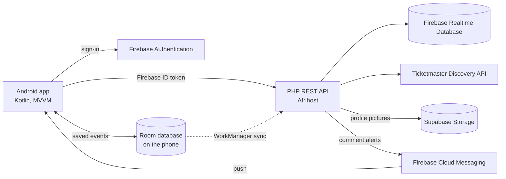
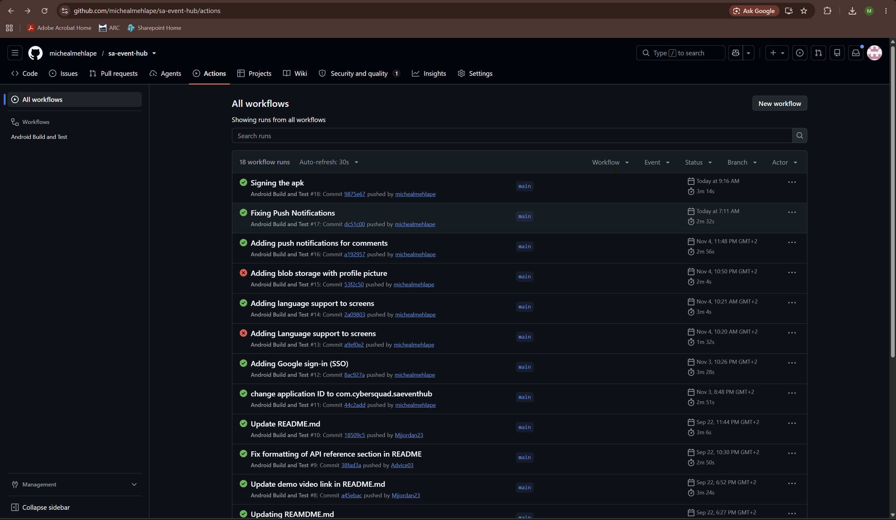
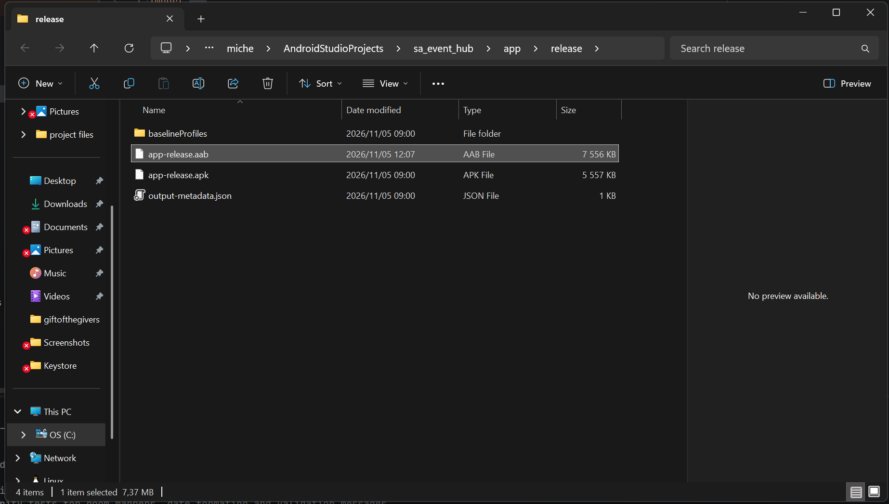
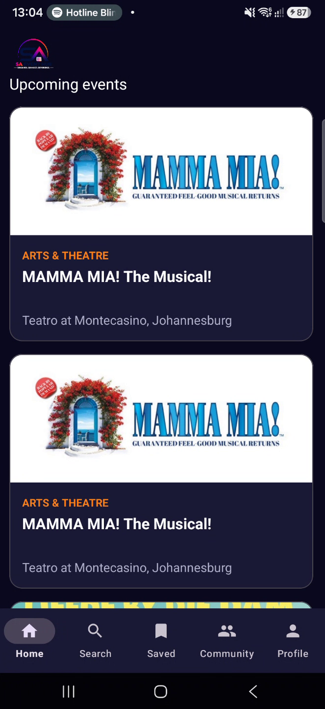
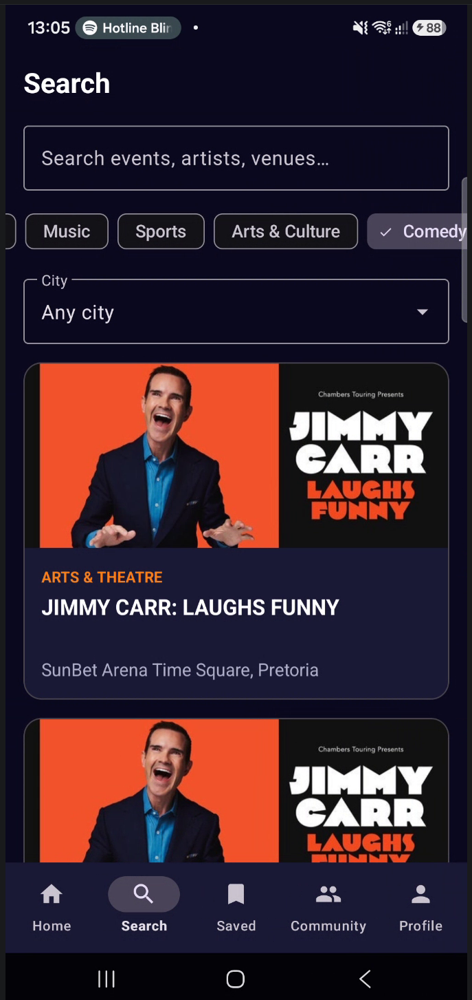
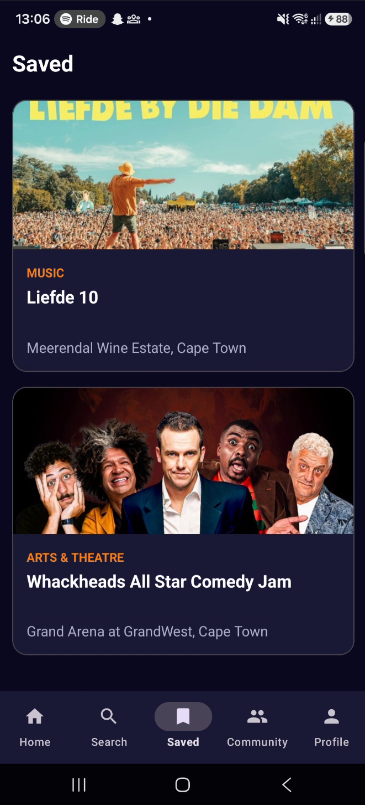
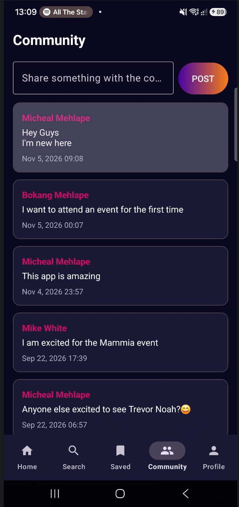
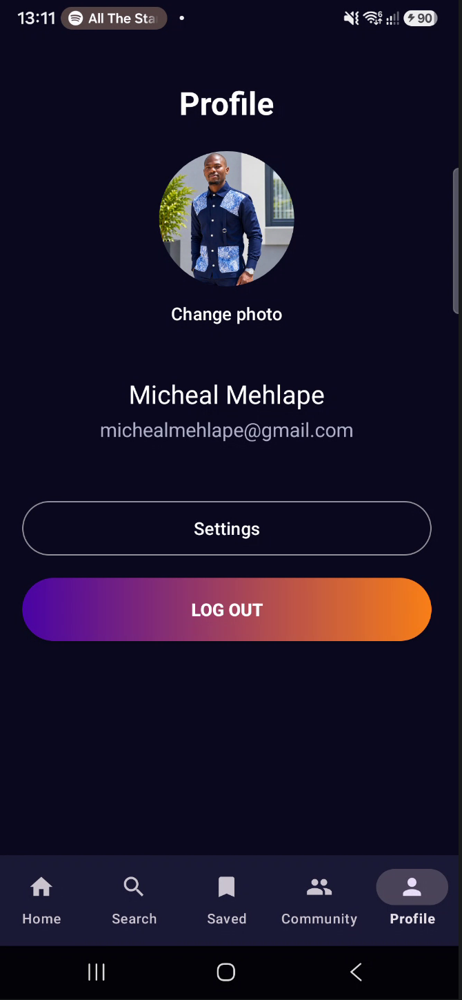
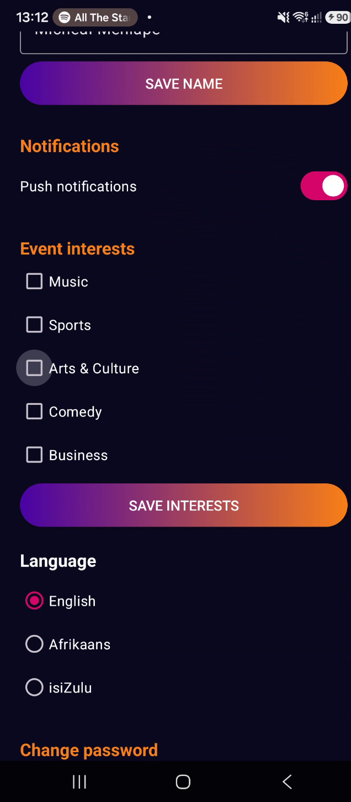

# SA Event Hub

> **Discover. Connect. Experience.**
> An Android app for finding live events across South Africa, saving the ones you
> like, and talking about them with other fans. Built by **CyberSquad** for
> OPSC6312 (Open Source Coding).

## Group members

- Michael Mehlape — ST0102939
- Advice Ngobene — ST10456753
- Murendeni Nethenzheni — ST10396326

## Demo video

**Final POE demo :** https://youtu.be/N8gRhiqTE94

---

## 1. Purpose of the app

South Africans find events on many different sites, and ticket links are often
buried. SA Event Hub puts events from across the country in one place. Users can
search and filter them, save favourites (even with no internet), get a notification
when someone comments on their community post, and buy tickets by following a link
to the official ticket seller. The app never handles payments.

## 2. Features

| Feature | Details |
|---|---|
| Register and log in | Firebase Authentication (email and password). Passwords are hashed by Firebase and are never stored by us. |
| Single sign-on | "Continue with Google" using Android Credential Manager and Firebase Auth |
| Settings | Change name, change password, notifications switch, event interests, language |
| Event discovery | Home list, keyword search and filters by category and city (Ticketmaster Discovery API) |
| Saved events | Save and remove favourites. Works **offline** and syncs when the phone is back online |
| Community | Create posts and comment on them |
| Push notifications | The author of a post is notified when someone comments (Firebase Cloud Messaging) |
| Profile picture | Choose a photo, shrink it on the phone, store it in **Supabase Storage** (blob storage) |
| Multi-language | English, Afrikaans and isiZulu, switchable inside the app |
| App icon and image assets | Custom launcher icon and notification icon |

## 3. Design considerations

- **MVVM.** Each screen has a ViewModel that holds its data and talks to the API or
  database. Screens only display what the ViewModel gives them, which keeps the code
  easy to test.
- **The phone never holds secrets.** The Ticketmaster key, the Supabase key and the
  Firebase service account all live on the server, outside the public web folder.
  The app only has a short-lived Firebase login token.
- **Offline first for saved events.** The screens read saved events from a local Room
  database. Saving or removing an event changes the local copy at once, and a
  background job sends the change to the server when there is internet.
- **Translated messages everywhere.** Error messages, validation messages, dates and
  notification text are all string resources, so they follow the language the user chose.
- **No payments.** Tickets are bought on the seller's website by following the link.
- **Invalid input never crashes the app.** Forms are checked before anything is sent,
  and network failures show a clear message in the user's language.

### Design change from Part 1

Part 1 proposed Firebase Cloud Functions and Cloud Firestore. Cloud Functions needs
the paid Firebase Blaze plan, so the backend was rebuilt as a PHP REST API on existing
Afrihost hosting, using Firebase Realtime Database instead of Firestore. Firebase
Authentication was kept.

## 4. Architecture

- **Android app:** Kotlin, XML layouts, MVVM (ViewModel and LiveData), Retrofit, Glide, Room, WorkManager.
- **Authentication:** Firebase Authentication (email/password and Google).
- **NoSQL database:** Firebase Realtime Database. The app only reaches it through the REST API.
- **Blob storage:** Supabase Storage (`avatars` bucket). The API uploads the picture; the app stores only its address.
- **REST API:** PHP 8.5 on Afrihost at `https://saeventhub.phatuditradings.co.za/`. Source in `/api`.
- **External data:** Ticketmaster Discovery API, called from the PHP API.

## 5. API reference

| Method | Endpoint | Auth | Description |
|---|---|---|---|
| GET | `/api/events` | No | List events (filters: city, category, page, size) |
| GET | `/api/events/search?q=` | No | Search events by keyword |
| GET | `/api/events/{id}` | No | Full details for one event |
| GET | `/api/favourites` | Yes | The logged-in user's saved events |
| POST | `/api/favourites` | Yes | Save an event: `{"eventId": "..."}` |
| DELETE | `/api/favourites/{id}` | Yes | Remove a saved event |
| GET | `/api/profile` | Yes | The logged-in user's profile (includes `photoUrl`) |
| PUT | `/api/profile` | Yes | Update name, language, interests, notifications, push token |
| POST | `/api/profile/photo` | Yes | Upload a profile picture (multipart field `photo`, JPEG/PNG/WebP, max 2 MB) |
| GET | `/api/community/posts` | Yes | List community posts |
| POST | `/api/community/posts` | Yes | Create a post: `{"body": "..."}` |
| GET | `/api/community/posts/{id}/comments` | Yes | List comments on a post |
| POST | `/api/community/posts/{id}/comments` | Yes | Add a comment and notify the post's author |

Authenticated endpoints need a Firebase ID token in the header:
`Authorization: Bearer <token>`.

## 6. How the new Part 3 features work

**Google sign-in.** The login screen asks Android's Credential Manager for a Google
account, then gives the Google token to Firebase Authentication. The API accepts the
resulting Firebase token exactly like an email login.

**Offline mode with sync.** Saved events live in a Room table with a sync state:
`SYNCED`, `PENDING_ADD` or `PENDING_DELETE`. A WorkManager job runs once the phone has
internet. It sends each pending change to the API, then fetches the server's list so
events saved on another device appear. The server wins once a change has been sent;
pending local changes are never overwritten.

**Profile pictures (blob storage).** The photo picker returns an image, the app shrinks
it to 512 px, and uploads it to `POST /api/profile/photo`. The API checks it is really
an image, stores it in Supabase Storage with the secret key (which never leaves the
server), and saves the public address in the user's profile.

**Push notifications.** The app registers its Firebase Cloud Messaging token on the
user's profile. When a comment is added, the API looks up the post's author and sends a
data message through FCM. The app builds the notification text itself, in the user's
chosen language. The token is deleted on log out, and the Settings switch is respected
on both the phone and the server.

**Multi-language.** English, Afrikaans (`values-af`) and isiZulu (`values-zu`). The
language is chosen in Settings and applied with `AppCompatDelegate.setApplicationLocales`.

## 7. Version control, GitHub Actions and testing

- Work was committed regularly to this repository, and the final commit is tagged as the final PoE.
- **Secrets are not committed.** `keystore.properties`, the API's private `config.php`
  and the Firebase service account are all kept outside the repository.
- **GitHub Actions** (`.github/workflows/build.yml`) runs on every push and pull request to `main`:
  1. check out the code,
  2. set up Java 17,
  3. run all unit tests (`./gradlew test`),
  4. build the debug APK (`./gradlew assembleDebug`),
  5. upload the APK as a build artifact.

- **Unit tests** (`app/src/test/java/com/example/sa_event_hub/`) cover:
  - input validation rules and their translated messages,
  - date formatting, including other languages,
  - the Room mapping between events and saved rows.

  Run them locally with `./gradlew test`

  

## 8. Publishing preparation

- Application ID `com.cybersquad.saeventhub` (the Play Store does not accept `com.example`).
- Release build signed with our own key and shrunk with R8, then tested on a physical phone.
- Release SHA-1 and SHA-256 fingerprints added to Firebase so Google sign-in works in the signed build.
- Custom launcher icon and a separate white notification icon.

**Evidence**

| Signed release file | App running on the phone |
|---|---|
|  |  |

## 9. Screenshots

| Home | Search | Saved (offline) |
|---|---|---|
|  |  |  |

| Community | Profile | Language settings |
|---|---|---|
|  |  |  |

## 10. Release notes

### Version 1.0.0 (final PoE)

**New since the prototype**

Innovative features
- **Offline saved events with sync.** Save or remove events with no internet; changes are sent automatically when the phone is back online.
- **Comment notifications.** Post authors get a push notification when someone comments, in their chosen language.
- **Profile pictures in blob storage.** Choose a photo; it is stored in Supabase Storage.
- **Three languages.** English, Afrikaans and isiZulu, with a language setting inside the app.

Other additions
- Google single sign-on.
- Language, notification and push-token settings are stored on the user's profile.
- New API endpoint `POST /api/profile/photo`; `PUT /api/profile` now accepts the push token.
- Custom app icon and notification icon.
- Signed, R8-shrunk release build prepared for the Play Store (application ID changed to `com.cybersquad.saeventhub`).
- More unit tests (entity mapping, translated dates, validation messages).
- Error, validation, date and notification text moved into translatable string resources.

**Changed**
- Saved events and the Save button now read from the local database, so they work offline.
- Event details fall back to the saved copy when the API cannot be reached.

**Known limits**
- The Home and Search lists need an internet connection; only saved events work offline.
- The isiZulu translations should be reviewed by a first-language speaker.

### Prototype (Part 2)
Registration and login, settings, event discovery and search, favourites, community posts and comments, PHP REST API, GitHub Actions build and tests.

## 11. AI use

Claude (Anthropic) was used throughout Part 3 as a coding assistant, debugging aid, and drafting tool.

**Planning and Setup** Claude assisted with changing the application ID, creating a signing key, configuring release signing, and setting up R8 for code optimization and obfuscation.

**Code Generation** and Implementation. Claude assisted with implementing and modifying the PHP API code to resolve connection issues. It also helped set up the Room database and WorkManager synchronization worker to support offline storage and synchronization of saved events. Claude also assisted with implementing language translations, configuring Supabase for blob storage, and improving Firebase Cloud Messaging, along with the PHP notification sender.

**Translations** Claude helped draft the Afrikaans and isiZulu translations used in the application.

**Debugging and Testing**

Claude helped diagnose and resolve several technical issues, including a Room database build configuration problem, a 405 error caused by the order of API routes, a blank API page following a PHP code edit, an error log being accessed from the wrong location, and a notification failure caused by a change in the Firebase PHP library. Proposed code changes were tested to verify that they worked as expected.

